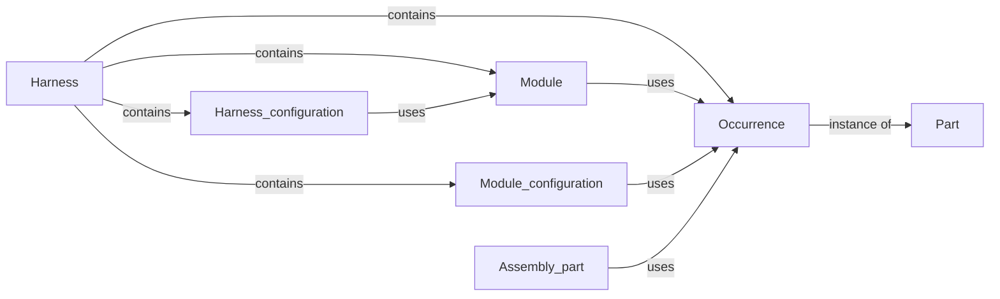
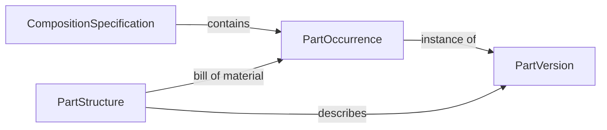
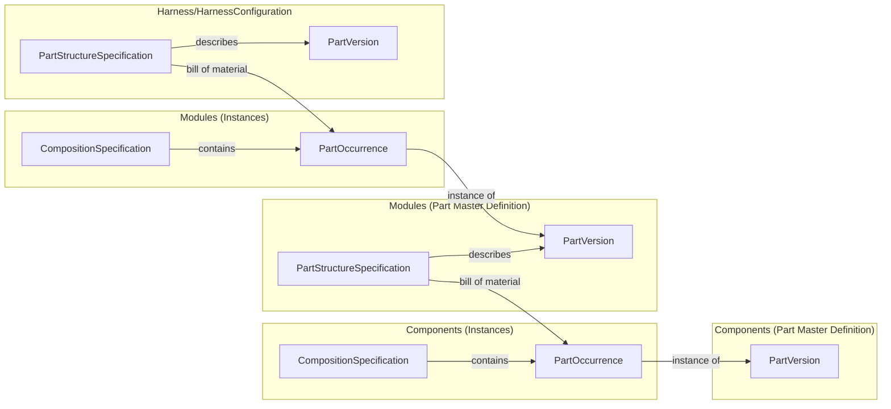



> **Editorial Note:** Since the creation of this implementation guideline will span an extended period, the current work-in-progress versions will be published continuously to allow the community to review and provide feedback.

This implementation guideline outlines the core concepts needed to create a dataset for a single wiring harness in the VEC, which is also the use case that lies in the center of the scope of the KBL.

To ease adoption for those already familiar with the KBL, this guideline is structured as a mapping from the KBL model to the VEC model: it explains the VEC concepts together with the KBL concepts they correspond to and shows where the information of a KBL file is found in a VEC. Additionally, a reference implementation of a KBL-to-VEC converter is available on [GitHub](https://github.com/4Soft-de/harness-model/tree/develop/kbl2vec/).

{} **Disclaimer:** This implementation guideline (along with the converter implementation) covers only the scope of the KBL. The VEC is a far more expressive model.

As a result, there are scenarios where the VEC could convey information with much clearer semantics. However, the necessary data for this level of precision is often not available in the KBL (e.g., detailed component data) or is embedded through custom properties and process/tool-specific dialects. "Healing" such data would require in-depth knowledge of the specific KBL dialect used and, in many cases, the integration of additional information sources (side-loading). This task lies outside the scope of this guideline. In situations where it is obvious that fixing of such deficiencies is advised, a **Data Quality** note is added.

The goal of this guideline is to demonstrate how standard KBL concepts map to VEC concepts—without improving the quality of the underlying information. While the VEC could indeed express many aspects more precisely, this guideline focuses on maintaining consistency with the original KBL data quality.{}

There are fundamentally two approaches to describing such a mapping. One can either start from the source model, explaining how its information is distributed into the target model, or take the opposite approach by defining which information is needed in the target model and where to find it in the source model. For this implementation guideline, the latter approach was chosen as the strategy.

On the one hand, the guideline's focus is on how to describe a harness in the VEC, which naturally suggests describing the mapping from this perspective. On the other hand, the VEC is the more precise model, meaning that many KBL concepts are distributed across different elements within the VEC. For example, a KBL  contains information relevant to the VEC concepts of a  ,  and . It is more logical to describe the mapping of topology and 2D/3D geometry as cohesive units rather than addressing all three concepts in a mixed manner starting from the KBL Node.

The implementation guideline focuses on the structural mapping and covers individual attributes only where they are essential for understanding a concept. If you are interested in those details, please refer to the reference implementation. The guideline describes the concepts and not the converter: where the reference implementation currently deviates from this guideline or does not yet cover a concept, this is pointed out briefly.

The guideline follows a logical order rather than an order dictated by model dependencies. Since the VEC is a graph—not a strict tree—it allows cross-references between branches. As a result, you may encounter cases where a model element references another model element whose mapping is described later in this guideline.

A converter can address this challenge with a two-phase approach, as the reference implementation does: first all VEC elements are created, then the references between them are resolved.

The order of the sections follows the content of a harness description in the VEC (see [Product Definition of a Harness]()):

1. The [Overview]() shows how the content of a KBL file is distributed across the VEC and introduces the principles that recur in all sections.
2. [Parts and Documents]() explains how KBL parts become s and s.
3. [Part Master Data]() describes the components used in the harness (connectors, terminals, wires, ...).
4. [Harness Description]() describes the harness itself: the instances of the components, the bill of material, the variants, the connectivity, and the topology with geometry, placement and routing.
5. [Basic Data Types]() covers the value types used everywhere (units, numerical values, strings, custom properties).

{}
VEC XML snippets in this guideline are taken from the KBL to VEC conversion output of the reference implementation. Input for that is the sample KBL file [Volkswagen - VOBES - Component Box](). Both the KBL file and the resulting VEC file can be downloaded at the top of this page. The KBL file is the version used in the tests of the reference implementation. It differs from the published sample in two details: the node reference to the component box is corrected (in the published sample it references the `Component_box_occurrence`, which cannot be placed on a node), and a `Housing_code` is added to one connector housing.

Note the versions of the example files: the KBL file is a KBL 2.4 file, while the KBL class links in this guideline refer to KBL 2.5 (the classes used here are the same in both versions). The VEC file declares `VecVersion` 2.1.0, although this guideline targets VEC 2.2; where this makes a difference, it is mentioned in the text.

Topics that are not contained in this sample (e.g. wire protections, fixings, multi-core wires, module lists) are illustrated with other [sample files](https://github.com/4Soft-de/harness-model/tree/develop/kbl2vec/src/test/resources) of the reference implementation.
{}

## Overview

Everything starts with the model root element , see the figure below (all attributes omitted).



A KBL file (`KBL_container`) describes exactly one harness together with the parts used in it. In the VEC, this information is distributed as follows (the figure is conceptual and not precise syntax):



- Every KBL  (including the  and its s) is identified by a .
- The properties of the components (connectors, terminals, wires, ...) are described in one `PartMaster` document per component.
- Everything that is specific to the harness—the instances of the components, the bill of material, the variants, the connectivity, the topology, the geometry, the placements and the routings—is contained in a single `HarnessDescription` document.

The following table shows where the KBL content is found in the VEC and in which section of this guideline the mapping is described.

| KBL | VEC | Section |
|-----|-----|---------|
|  (all subclasses) |  | [PartVersions]() |
| Components (e.g. , ) |  (`PartMaster`) with s | [Part Master Data]() |
|  |  (`HarnessDescription`) | [Harness Description]() |
|  |  with s | [Instances of Components]() |
| , ,  |  | [Bill of Material]() |
|  (of a module or of the harness),  | , , ,  | [Variant Management]() |
| ,  | , ,  | [Connectivity]() |
| ,  |  | [Topology]() |
| , , `Placement` |  /  | [Geometry]() |
| `Referenced_components`, ,  |  | [Placement]() |
|  |  | [Routing]() |
| , , ... | , , ... | [Basic Data Types]() |

### Mapping Principles

The following principles recur throughout the mapping:

**Part and usage.** Like the KBL, the VEC distinguishes between the definition of a component type (KBL , e.g. ) and its use in the harness (KBL , e.g. ). In the VEC, the definition is made with s in the `PartMaster` document of the component, the use with s and s in the harness description (see the guideline [Component Instances]()). Since the KBL already follows this distinction, most concepts can be mapped in a straightforward manner.

**One KBL element, several VEC elements.** The VEC is more modular than the KBL. A KBL element often contains information that belongs to different views in the VEC. For example, a KBL  contains information about the topology (), the geometry ( or ) and the placement of components (). Each view is described in its own section of this guideline.

**Identification.** VEC elements are identified by their `Identification` attribute, which must be unique within its context (see [Identifiers]()). Where the KBL provides an `Id`, it is used. Where the VEC requires an identification that has no counterpart in the KBL (e.g. for the specifications of a part), the reference implementation derives one, e.g. from the abbreviated class name and the part number (`CHS-ECP001706` for the  of the part `ECP001706`). Such derived identifications are a convention of the reference implementation and not a VEC rule.

## Parts and Documents

In the KBL, a  combines the identification of a component (part number, version, company) with its technical description. The VEC separates both: the  identifies the part, the technical description is contained in the s of a  (see [General Structure – Parts and Documents]()). Each KBL part therefore results in a  and, for a component, in a `PartMaster` document.

### PartVersions

The concept of parts is quite different in KBL and VEC. In the VEC a  is just a PDM-Header for the part. The various aspects of a part (e.g. is it a wire or connector) are handled by different types of s contained in the  describing the part. In the KBL, the different types of parts are expressed as subclasses of . The concept in the VEC that most closely reflects the approach of the KBL is the . 

{}
**Data Quality**: The mapping between KBL  subtypes and the  is merely a preliminary "best guess" approach. In many cases, the "standard" KBL provides only a very general classification, whereas the VEC allows for more specific distinctions. For example, the KBL only recognizes , while the VEC differentiates between , , and others.
{}

The following  could be used for KBL Parts:

| KBL Class   | VEC PrimaryPartType   |
|--------------|------------------------|
|  | `Other` |
|  | `Other` |
|  | `CavityPlug` |
|  | `CavitySeal` |
|  | `Wire` |
|  | `ConnectorHousing` |
|  | `Fixing` |
|  | `Terminal` |
|  | `WireProtection` |
|  | `PartStructure` |
|  | `PartStructure` |
|  | `PartStructure` |
|  | `PartStructure` |
|  | `Fuse` |
|  | `EEComponent` |
|  | `EEComponent` |

When mapping into the VEC, a  Object is required for each KBL . Those can be found under `/KBL_container/(Accessory|AssemblyPart|CavityPlug|...)`, `/KBL_container/Harness/Module` and `/KBL_container/Harness/Harness_configuration`.

The PDM attributes of the  are mapped directly to the : `Part_number`, `Company_name` and `Version` become `PartNumber`, `CompanyName` and `PartVersion`, which together identify the part in the VEC. `Abbreviation` and `Description` (and `Localized_description`) become localized strings (see [Strings and Localized Strings]()). Each  becomes an , where the KBL `Description` ("the type of the Alias_identification") is mapped to the `Type`. The `Part_number_type` corresponds to the `PartNumberType` of the .

```xml
<!-- KBL -->
    <Connector_housing id="id_315_0">
        <Part_number>ECP001706</Part_number>
        <Company_name>MaybeAnyCompany</Company_name>
        <Alias_id id="id_368_27">
            <Alias_id>TBL001038B</Alias_id>
            <Scope>VOBES</Scope>
            <Description>tab_number</Description>
        </Alias_id>
        <Version>1</Version>
        <Abbreviation>/NULL</Abbreviation>
        <Description>BUCHSENGEHAEUSE_6-POL</Description>
        ...
    </Connector_housing>
<!-- VEC -->
  <PartVersion id="PartVersion_id_315_0">
    ...
    <Description xsi:type="vec:LocalizedString" id="LocalizedString_00238">
      <LanguageCode>De</LanguageCode>
      <Value>BUCHSENGEHAEUSE_6-POL</Value>
    </Description>
    <CompanyName>MaybeAnyCompany</CompanyName>
    <PartNumber>ECP001706</PartNumber>
    <PartVersion>1</PartVersion>
    <PrimaryPartType>ConnectorHousing</PrimaryPartType>
    <AliasId id="AliasIdentification_id_368_27">
      <IdentificationValue>TBL001038B</IdentificationValue>
      <Type>tab_number</Type>
      <Scope>VOBES</Scope>
    </AliasId>
  </PartVersion>
```

{}
**Data Quality**: The KBL allows to have the same `Part_number` under different classifications (see  for more details). In the VEC, multiple occurrences of the same part version are considered a semantic error. In KBL data, there are two different reasons for such duplicates, which have to be treated differently:

1. **The same part is used in different roles.** For example, a tape can be used as  or as  to some other part, or a cable tie as  and as . Due to other modeling approaches in the VEC, there is no longer any need for this. The duplicates are merged into a single  whose `PartMaster` document contains all specifications that are required for the different aspects of the part (see [Hybrid and Composite Components]()). The occurrences are not affected: each of them references the merged  and has the role that corresponds to its usage.
2. **A workaround for terminals without a connector housing.** Typical examples are the cable lugs in VOBES data, which are defined both as  and as  with the same part number (e.g. `ECP001135` in the example file). Here, the  does not describe a real component: it is a "virtual" housing that is only needed because the KBL can attach wires to a terminal only via a contact point in a connector occurrence. Such parts must **not** be merged into one  with a  and a . Instead, the virtual housing has to be eliminated, which also changes the occurrences and the contacting. This is explained in detail in [Connector Housings – Virtual Connector Housings]().

Deduplication should be carried out in post-processing. The reference implementation does not perform it yet.
{}

### DocumentVersions



In the VEC, all payload data is contained within s. Typically, you would structure those according to the actual documents used in the process. Unfortunately, this concept in its detail form is not present in the KBL. Therefore, for the generic conversion described here, practical assumptions need to be made:

1. It is common practice to describe components in individual datasets/documents and publish them separately &rarr; one  for each harness component (e.g. connector, wire and terminal, see [Partitioning and Sizing]()), see section [Part Master Data]().
1. It is also common for a wiring harness to be fully described in a single 150% dataset, containing all information about the used component occurrences, variants, connectivity, dimensioning, and so on &rarr; one  for the harness itself, see section [Harness Description]().

This means that, for this mapping, a  with `DocumentType=PartMaster` must be created for each component used in the wiring harness. These are all instances of  in the KBL except instances of .

For the  itself, a  with `DocumentType=HarnessDescription` is created. This document contains all relevant information about the harness as well as the s for the s and s.

#### Identity of the Documents

Since the KBL has no explicit document concept, the identity of the documents must be derived. The natural choice is the identity of the described part: `DocumentNumber`, `DocumentVersion` and `CompanyName` of the document are taken from `Part_number`, `Version` and `Company_name` of the part, and the document references the part as `ReferencedPart`. If the identities of the actual documents in the process are known, they should be used instead.

```xml
  <DocumentVersion id="DocumentVersion_id_315_0">
    ...
    <CompanyName>MaybeAnyCompany</CompanyName>
    <DocumentNumber>ECP001706</DocumentNumber>
    <DocumentType>PartMaster</DocumentType>
    <DocumentVersion>1</DocumentVersion>
    <ReferencedPart>PartVersion_id_315_0</ReferencedPart>
    <RelatedDocument>DocumentVersion_External_reference_1</RelatedDocument>
    <Specification xsi:type="vec:ConnectorHousingSpecification" id="ConnectorHousingSpecification_id_315_0">
      <Identification>CHS-ECP001706</Identification>
      ...
```

The same applies to the `HarnessDescription`, whose identity is derived from the . A harness description defines not only the harness, but also its modules and harness configurations. All s defined in the document should therefore be referenced as `ReferencedPart` (see [Product Definition of a Harness]()). The reference implementation currently references only the  of the harness.

```xml
  <DocumentVersion id="DocumentVersion_id_328_0_1">
    ...
    <CompanyName>MaybeAnyCompany</CompanyName>
    <DocumentNumber>LTG0011200</DocumentNumber>
    <DocumentType>HarnessDescription</DocumentType>
    <DocumentVersion>2.4.0</DocumentVersion>
    <ReferencedPart>PartVersion_id_328_0</ReferencedPart>
    <RelatedDocument>DocumentVersion_External_reference_12 DocumentVersion_id_322_0 DocumentVersion_id_322_1</RelatedDocument>
    ...
```

### Title Block and PDM Information

The KBL distributes the information of a drawing title block over several places: ,  and  are defined directly in the `KBL_container` and reference the parts they apply to (`Is_applied_to`); a  can have s and a `Copyright_note`; and the  (i.e. the ,  and ) adds project and car classification information. In the VEC, this is meta information of the  that contains the definition (see [PDM Information]()), and in some cases of the .

| KBL | VEC |
|-----|-----|
|  (`Name`, `Department`, `Date`) |  of the  |
|  (`Name`, `Department`, `Date`, `Type_of_approval`) |  of the  |
| `Change` () and  |  of the  |
| `Copyright_note` |  in the , referenced by the  /  |
| `Project_number`, `Car_classification_level_2` to `_4` |  in the , referenced by the  |

The target  of a ,  or  is the document that describes the part referenced by `Is_applied_to`. The structures are not identical: in the VEC, persons are described by a , and some attributes are mandatory that have no KBL source (e.g. the `Status` of an ), so they have to be filled with a default value (see [Default Values]()).

The title block information of the KBL  belongs to the `HarnessDescription`. The title block information of a  or  does not have a document of its own in the VEC, since modules and configurations are defined within the `HarnessDescription`. Where it differs from the harness, it can only be preserved on the  (e.g. , ).

{}
**Data Quality**: The dates in the KBL are strings without a defined format (e.g. `270115` in the example file), whereas the VEC uses `xs:date` / `xs:dateTime`. A conversion requires knowledge of the date format used in the KBL dialect.

The reference implementation does not convert the title block information yet.
{}

### External References

A KBL  identifies a document that is not part of the KBL file (e.g. a 3D model or a drawing). Its counterpart in the VEC is a  that contains only PDM information and no specifications (see [Usages of the DocumentVersion]()). `Document_number`, `Change_level`, `Data_format`, `Creating_system` and `Location` are mapped to the attributes of the same meaning. The KBL `Document_type` literals (`part master`, `geometry model`, `harness description`, ...) have direct counterparts in the VEC  (`PartMaster`, `GeometryModel`, `HarnessDescription`, ...). Values outside the KBL enumeration are kept as they are.

```xml
<!-- KBL -->
    <External_reference id="External_reference_1">
        <Document_type>EKR</Document_type>
        <Document_number>ECP001706</Document_number>
        <Change_level>011112</Change_level>
        <File_name>ECP001706.CATPart</File_name>
        <Data_format>catPart</Data_format>
        <Creating_system>CATIA V5R19 SP9</Creating_system>
    </External_reference>
<!-- VEC -->
  <DocumentVersion id="DocumentVersion_External_reference_1">
    <CompanyName>ACME Inc.</CompanyName>
    <DocumentNumber>ECP001706</DocumentNumber>
    <DocumentType>EKR</DocumentType>
    <DocumentVersion>011112</DocumentVersion>
    <CreatingSystem>CATIA V5R19 SP9</CreatingSystem>
    <DataFormat>catPart</DataFormat>
    <FileName>ECP001706.CATPart</FileName>
  </DocumentVersion>
```

Two details need attention:

- The `CompanyName` is mandatory in the VEC, but the KBL  has no company. If the company is not known from the context, `/NULL` should be used (see [Default Values]()). The value `ACME Inc.` in the example is a placeholder of the reference implementation.
- The `FileName` of a VEC  is reserved for documents that are part of the VEC package; otherwise it shall be omitted (see [External References]()). The KBL `File_name` refers to a file outside of the KBL, so it should only be kept if the document is packaged together with the VEC file. The document can still be resolved via its domain key or via the `Location`, if given in the KBL.

The KBL `External_references` of a  are the documents associated with the part (e.g. its 3D model). In the VEC, this relation can be expressed with different associations; the one with the most specific semantics should be chosen (see [External References]()). For documents describing the part, this is `ReferencedPart` of the referenced . The reference implementation uses the more general `RelatedDocument` of the `PartMaster` document (see the example above).


## Part Master Data

For all components used in a wiring harness, a minimum set of part master data is required. 
A `PartMaster` document contains all s that are required to describe the component. For a general description of this concept see  the Guideline "[Component Description]()". The specifications that have to be created are listed below. The mapping of those is described in the following sections.

{}
**Data Quality**: Since the scope of the KBL is the product definition of a harness, the contained master data is limited to the bare minimum (e.g. cavities of a connector, cross section area and color of the wire). On the other hand, the VEC offers a wide range of options for a detailed component description. In a real scenario, it would therefore be more likely to enrich the data with information from a library during conversion than to transfer the master data from the KBL directly 1:1.
{}

The following table defines the  that are used to define each . Auxiliary specifications that might be required by the  for a complete definition (e.g. ,  or ) are listed in the corresponding section.

| KBL Class   | VEC PartOrUsageRelatedSpecification   | Section |
|--------------|------------------------|---------|
|  | ,  | [Connector Housings]() |
|  |  | [Terminals]() |
|  |  | [Cavity Seals and Cavity Plugs]() |
|  |  | [Cavity Seals and Cavity Plugs]() |
|  |  | [Wires]() |
|  |  (or a more specific subclass),  | [Wire Protections, Fixings and Accessories]() |
|  | ,  | [Wire Protections, Fixings and Accessories]() |
|  | ,  | [Wire Protections, Fixings and Accessories]() |
|  |  | [Wire Protections, Fixings and Accessories]() |
|  |  | [Component Boxes, Fuses and other E/E Components]() |
|  | ,  | [Component Boxes, Fuses and other E/E Components]() |
|  |  | [Component Boxes, Fuses and other E/E Components]() |
|  | ,  | [Assembly Parts]() |

In addition, every part receives a  (see [General Technical Information]()). The , its s and s do not have a `PartMaster` document. They are defined in the `HarnessDescription` (see [Bill of Material / Part Structure]()).

The  is required for all components that are placed on the topology (see [Placement]()). In the KBL, these are the components whose occurrences can be referenced by a  (`Referenced_components`), by a  or by a .

### General Technical Information

In this mapping, every part receives a  (this is a convention, the VEC does not require it); that is, for each instance of a KBL , such a specification is created in its describing . This specification covers basic technical information about the component, such as dimensions, weight, material, and dependencies to other parts.

| KBL | VEC  |
|-----|-----|
| `Mass_information` () | `MassInformation` |
| `Material_information` () | `MaterialInformation` |
| `Housing_colour` (), `Colour` (, , ) | `ColorInformation` |

The XML representation for the multi-fuse of the example file looks as follows:

```xml
<!-- KBL -->
    <Assembly_part id="id_304_1">
        <Part_number>AS0105563</Part_number>
        ...
        <Mass_information id="id_380_1">
            <Unit_component>id_346_2</Unit_component>
            <Value_component>47.7</Value_component>
        </Mass_information>
        ...
<!-- VEC -->
    <Specification xsi:type="vec:GeneralTechnicalPartSpecification" id="GeneralTechnicalPartSpecification_id_304_1">
      <Identification>GTPS-AS0105563</Identification>
      <DescribedPart>PartVersion_id_304_1</DescribedPart>
      <MassInformation id="MassInformation_id_380_1">
        <Value id="NumericalValue_id_380_1">
          <UnitComponent>SIUnit_id_346_2</UnitComponent>
          <ValueComponent>47.7</ValueComponent>
        </Value>
      </MassInformation>
    </Specification>
```

In the KBL, colours and materials are plain strings. In the VEC, a  and a  consist of a key and the reference system that defines the meaning of the key (e.g. `RAL` for colours). The reference system is not contained in the KBL and must be known from the context of the KBL dialect (e.g. a company specific colour code).

{}
The reference implementation uses the placeholder `ACME Inc.` as reference system. It also attaches the KBL `Processing_information` of a part as  to the . Since a  should contain only PDM information, the  is the better place for them (see [Custom Properties and Instructions]()).
{}

### Connector Housings

A KBL  has the same basic structure as a VEC : the housing consists of s, which consist of s. Both are mapped 1:1 to a  and a , where the `Id` of the KBL slot becomes the `SlotNumber` and the `Cavity_number` becomes the `CavityNumber`. The `Housing_code` is mapped to the  and the `Housing_type` to the `SpecialPartType` of the . The `Number_of_cavities` of a KBL slot can be represented by a .

Since connectors are placed on the topology, a  with `ValidPlacementTypes=OnPoint` is added to the `PartMaster` document.

```xml
<!-- KBL -->
    <Connector_housing id="id_315_0">
        <Part_number>ECP001706</Part_number>
        ...
        <Housing_colour>schwarz</Housing_colour>
        <Housing_code>A</Housing_code>
        <Slots id="id_341_0">
            <Id>default</Id>
            <Number_of_cavities>6</Number_of_cavities>
            <Cavities id="id_370_0">
                <Cavity_number>1</Cavity_number>
            </Cavities>
            ...
        </Slots>
    </Connector_housing>
<!-- VEC -->
    <Specification xsi:type="vec:ConnectorHousingSpecification" id="ConnectorHousingSpecification_id_315_0">
      <Identification>CHS-ECP001706</Identification>
      <DescribedPart>PartVersion_id_315_0</DescribedPart>
      <Coding id="Coding_00024">
        <Coding>A</Coding>
      </Coding>
      <Slot xsi:type="vec:Slot" id="Slot_id_341_0">
        <SlotNumber>default</SlotNumber>
        <Cavity id="Cavity_id_370_0">
          <CavityNumber>1</CavityNumber>
        </Cavity>
        ...
      </Slot>
    </Specification>
    <Specification xsi:type="vec:PlaceableElementSpecification" id="PlaceableElementSpecification_id_315_0">
      <Identification>PES-ECP001706</Identification>
      <DescribedPart>PartVersion_id_315_0</DescribedPart>
      <ValidPlacementTypes>OnPoint</ValidPlacementTypes>
    </Specification>
    <Specification xsi:type="vec:GeneralTechnicalPartSpecification" id="GeneralTechnicalPartSpecification_id_315_0">
      <Identification>GTPS-ECP001706</Identification>
      <DescribedPart>PartVersion_id_315_0</DescribedPart>
      <ColorInformation id="Color_00025">
        <Key>schwarz</Key>
        <ReferenceSystem>ACME Inc.</ReferenceSystem>
      </ColorInformation>
    </Specification>
```

#### Virtual Connector Housings

Not every  in a KBL file describes a real connector. Many KBL files contain "virtual" connector housings, which are a workaround for a gap in the KBL model.

**Background.** The KBL attaches a wire to a terminal via a : the  of the  references the contact point, and the contact point references the terminal (`Associated_parts`) and the cavity (`Contacted_cavity`). Contact points, however, can only be defined in a  (or a ). The  was introduced to describe terminals that are not inserted into a connector housing, e.g. ring terminals or cable lugs, but it cannot contain contact points. A wire therefore cannot be attached to it directly. As a workaround, a connector housing is defined whose only purpose is to provide a home for the contact point. The same workaround is used for splices and for wire ends without a connector ("danglers").

**Dialects.** The workaround has been implemented differently by the individual KBL dialects, for example:

- The virtual  has the part number of the terminal (as for the cable lugs in VOBES data) or a dummy part number.
- The virtual  is marked with a `Usage` (`ring terminal`, `splice`, `dangler`, `no end`) or not at all.
- The terminal is instantiated as a , as a , or not at all (e.g. for splices without material).
- The virtual housing has slots and cavities (sometimes with the slot `Id` `none`), which are referenced as `Contacted_cavity`.
- The node that places the element references the virtual connector occurrence or the terminal occurrence.

The example file contains such a case for the battery terminal `XA.A.1`. The part `ECP001135` is defined both as  (with one slot `none` and one cavity) and as  (`cable_shoe`). In the harness, `XA.A.1` is instantiated twice: as a  with `Usage=ring terminal`, which contains the contact point, and as a , which is associated with the contact point and placed on the node.

```xml
<!-- KBL -->
    <Connector_housing id="id_315_9">
        <Part_number>ECP001135</Part_number>
        ...
        <Description>BATTERIEKLEMME_PLUS</Description>
        ...
        <Slots id="id_341_21">
            <Id>none</Id>
            <Number_of_cavities>1</Number_of_cavities>
            <Cavities id="id_370_62">
                <Cavity_number>1</Cavity_number>
            </Cavities>
        </Slots>
    </Connector_housing>
    ...
    <General_terminal id="id_326_11">
        <Part_number>ECP001135</Part_number>
        ...
        <Description>cable_shoe</Description>
        <Terminal_type>special</Terminal_type>
        <Plating_material>sn</Plating_material>
    </General_terminal>
    ...
        <Connector_occurrence id="id_316_12">
            <Id>XA.A.1</Id>
            <Usage>ring terminal</Usage>
            <Part>id_315_9</Part>
            <Contact_points id="id_372_4">
                <Id>XA.A.1-1#100_4_XA.SR1.1_1_1</Id>
                <Associated_parts>id_342_4</Associated_parts>
                <Contacted_cavity>id_370_63</Contacted_cavity>
            </Contact_points>
            ...
            <Slots id="id_341_22">
                <Part>id_341_21</Part>
                <Cavities id="id_370_63">
                    <Part>id_370_62</Part>
                </Cavities>
            </Slots>
        </Connector_occurrence>
        ...
        <Special_terminal_occurrence id="id_342_4">
            <Id>XA.A.1</Id>
            ...
            <Part>id_326_11</Part>
            ...
    <Node id="Node_15">
        ...
        <Referenced_components>id_342_4</Referenced_components>
    </Node>
```

**Mapping to the VEC.** The VEC does not have this gap: a  is not contained in a connector, and it can reference a terminal without a cavity. The virtual connector housing is therefore not mapped; instead, the workaround is resolved:



| KBL | VEC |
|-----|-----|
| virtual  | no . If it has the part number of the terminal, its  is the one of the terminal, with a terminal specification only. A dummy part has no  at all. |
|  |  with the specification of the terminal type (, , ...) and a  |
| virtual  and the terminal occurrence | **one**  of the terminal with the corresponding role (e.g. ) and a . Identification, alias ids, descriptions and installation information of both KBL occurrences are combined. The slot and cavity occurrences of the virtual housing are not mapped. |
|  |  with the terminal role as `MountedTerminal` and a  for the wire ends, but **without**  (see [Wiring – Ringterminal - Splice]()) |
| `Referenced_components` of the  (virtual connector occurrence or terminal occurrence) |  of the  of the terminal occurrence |

For the other kinds of virtual connectors, the same applies with a different target:

- **Splices** (`Usage=splice`): the splice is a terminal with a  and a . If the KBL contains no terminal for the splice (e.g. for ultrasonic welding), the specification describes the process instead of a real component (see [Splices]()).
- **Wire ends without a connector** (`Usage=dangler` or `no end`): there is no component at the wire end. If the location of the open wire end is relevant, it can be described with an  and an .

Whether a connector housing is virtual cannot always be decided from the KBL alone. Indications are the `Usage` of the occurrence, a part number that is also used for a terminal, a dummy part number or a slot `none`; the actual rules depend on the KBL dialect.

{}
The reference implementation does not resolve virtual connector housings yet. It maps them as real connector housings, and the duplicate part numbers of housing and terminal result in two s with the same identity.
{}

### Terminals

A KBL  is described with a few flat attributes. The VEC  describes the inner structure of a terminal: a  for the connection of the wire, a  for the connection to the mating terminal, and an  between them. The properties of the receptions are defined by a  and a , which are auxiliary specifications in the same `PartMaster` document.

For a terminal from the KBL, this structure consists of exactly one wire reception, one terminal reception and the connection between them. The attributes of the KBL terminal are distributed as follows:

| KBL  | VEC |
|-----|-----|
| `Terminal_type` | `SpecialPartType` of the . Special terminal types have their own specification classes, e.g.  or . |
| `Plating_material` | `PlatingMaterial` of the  (and of the , if it applies to the whole terminal) |
| `Cross_section_area` | `CoreCrossSectionArea` of the  |
| `Outside_diameter` | `WireElementOutsideDiameter` of the  |

```xml
<!-- KBL -->
    <General_terminal id="id_326_0">
        <Part_number>TER00156401</Part_number>
        ...
        <Plating_material>au</Plating_material>
    </General_terminal>
<!-- VEC -->
    <Specification xsi:type="vec:TerminalSpecification" id="TerminalSpecification_id_326_0">
      <Identification>TS-TER00156401</Identification>
      <DescribedPart>PartVersion_id_326_0</DescribedPart>
      <InternalTerminalConnection id="InternalTerminalConnection_id_326_0">
        <Identification>ITC</Identification>
        <TerminalReception>TerminalReception_id_326_0</TerminalReception>
        <WireReception>WireReception_id_326_0</WireReception>
      </InternalTerminalConnection>
      <TerminalReception id="TerminalReception_id_326_0">
        <Identification>TR</Identification>
        <TerminalReceptionSpecification>TerminalReceptionSpecification_id_326_0</TerminalReceptionSpecification>
      </TerminalReception>
      <WireReception id="WireReception_id_326_0">
        <Identification>WR</Identification>
        <WireReceptionSpecification>WireReceptionSpecification_id_326_0</WireReceptionSpecification>
      </WireReception>
    </Specification>
    <Specification xsi:type="vec:WireReceptionSpecification" id="WireReceptionSpecification_id_326_0">
      <Identification>WRS</Identification>
    </Specification>
    <Specification xsi:type="vec:TerminalReceptionSpecification" id="TerminalReceptionSpecification_id_326_0">
      <Identification>TRS</Identification>
      <PlatingMaterial id="Material_00048">
        <Key>au</Key>
        <ReferenceSystem>ACME Inc.</ReferenceSystem>
      </PlatingMaterial>
    </Specification>
```

Terminals that are used on their own and placed on the topology (KBL , e.g. a ring terminal at a ground bolt) additionally require a .

{}
The structure with one wire reception and one terminal reception does not fit all terminal types. An end splice, for example, has only a wire reception (see [Splices]()). If the `Terminal_type` indicates such a terminal, the structure should be adapted accordingly. The reference implementation creates the same structure for all terminals.
{}

### Cavity Seals and Cavity Plugs

Cavity seals and cavity plugs are mapped to a  and a .

| KBL | VEC |
|-----|-----|
| `.Seal_type` | `SpecialPartType` of the  |
| `.Wire_size` | `WireElementOutsideDiameter` of the  |
| `.Plug_type` | `SpecialPartType` of the  |
| `Colour` | `ColorInformation` of the  |

The cavity in which a seal or plug is used and the wire that is sealed are not part of the part master data. They are described by the [Connectivity]() of the harness.

### Wires

A KBL  describes a wire with flat attributes. If it is a multi-core wire, it contains a list of s with similar attributes. The VEC describes a wire as a tree of s in a . Each  references a , which defines its properties with a  (here: ) and an . The background of this structure is explained in the guideline [Wires]().

The instances of a wire in the harness do not reference the specifications, but the s (see [Instances of Components]()). This is why a  is required for every wire and every core, although it has no direct counterpart in the KBL.

**Single cores.** A  without s is a single core. For single cores, the minimal representation shall be used (see [Wires – Definition of a Single Core]()): one  with one  that references both the  and the .

```xml
<!-- KBL -->
    <General_wire id="id_327_1">
        <Part_number>WIR0010006</Part_number>
        ...
        <Wire_type>individual wire</Wire_type>
        <Bend_radius id="id_369_1">
            <Unit_component>id_346_1</Unit_component>
            <Value_component>4</Value_component>
        </Bend_radius>
        <Cross_section_area id="id_375_1">
            <Unit_component>id_346_0</Unit_component>
            <Value_component>0.5</Value_component>
        </Cross_section_area>
        <Outside_diameter id="id_381_1">
            <Unit_component>id_346_1</Unit_component>
            <Value_component>1</Value_component>
        </Outside_diameter>
        <Cover_colour id="id_374_1">
            <Colour_type>Grundfarbe</Colour_type>
            <Colour_value>ws</Colour_value>
        </Cover_colour>
        <Cover_colour id="id_374_2">
            <Colour_type>Kennfarbe</Colour_type>
            <Colour_value>gn</Colour_value>
        </Cover_colour>
    </General_wire>
<!-- VEC -->
    <Specification xsi:type="vec:WireSpecification" id="WireSpecification_id_327_1">
      <Identification>WS-WIR0010006</Identification>
      <DescribedPart>PartVersion_id_327_1</DescribedPart>
      <WireElement id="WireElement_id_327_1">
        <Identification>WIRE</Identification>
        <WireElementSpecification>WireElementSpecification_id_327_1</WireElementSpecification>
      </WireElement>
    </Specification>
    <Specification xsi:type="vec:WireElementSpecification" id="WireElementSpecification_id_327_1">
      <Identification>WIRE</Identification>
      <Type id="WireType_00088">
        <Type>individual wire</Type>
        <ReferenceSystem>ACME Inc.</ReferenceSystem>
      </Type>
      <MinBendRadiusStatic id="NumericalValue_id_369_1">
        ...
      </MinBendRadiusStatic>
      <OutsideDiameter id="NumericalValue_id_381_1">
        ...
      </OutsideDiameter>
      <ConductorSpecification>CoreSpecification_id_327_1</ConductorSpecification>
      <InsulationSpecification>InsulationSpecification_id_327_1</InsulationSpecification>
    </Specification>
    <Specification xsi:type="vec:InsulationSpecification" id="InsulationSpecification_id_327_1">
      <Identification>WIRE-INS</Identification>
      <BaseColor id="Color_00089">
        <Key>ws</Key>
        <ReferenceSystem>ACME Inc.</ReferenceSystem>
      </BaseColor>
      <FirstIdentificationColor id="Color_00090">
        <Key>gn</Key>
        <ReferenceSystem>ACME Inc.</ReferenceSystem>
      </FirstIdentificationColor>
    </Specification>
    <Specification xsi:type="vec:CoreSpecification" id="CoreSpecification_id_327_1">
      <Identification>WIRE-CORE</Identification>
      <CrossSectionArea id="NumericalValue_id_375_1">
        <UnitComponent>SIUnit_id_346_0</UnitComponent>
        <ValueComponent>0.5</ValueComponent>
      </CrossSectionArea>
    </Specification>
```

**Multi-core wires.** A  with s becomes a  for the whole cable with one sub wire element per core. The  of the cable carries the properties of the cable (e.g. outside diameter, bend radius) and the  of the jacket, but no conductor. Each core has its own  with a  and an .



The `Id` of the core is used as identification of its . The following excerpt shows the structure for a two-core cable of the [KSK sample](https://github.com/4Soft-de/harness-model/tree/develop/kbl2vec/src/test/resources) of the reference implementation:

```xml
    <Specification xsi:type="vec:WireSpecification" id="WireSpecification_id_327_89">
      <Identification>WS-O10a71692144</Identification>
      ...
      <WireElement id="WireElement_id_327_89">
        <Identification>WIRE</Identification>
        <WireElementSpecification>WireElementSpecification_id_327_89</WireElementSpecification>
        <SubWireElement id="WireElement_id_317_0">
          <Identification>2-ws@N_906_581_33</Identification>
          <WireElementSpecification>WireElementSpecification_id_317_0</WireElementSpecification>
        </SubWireElement>
        <SubWireElement id="WireElement_id_317_1">
          <Identification>1-ws@N_906_581_33</Identification>
          <WireElementSpecification>WireElementSpecification_id_317_1</WireElementSpecification>
        </SubWireElement>
      </WireElement>
    </Specification>
```

The KBL cannot express further inner structures of a multi-core wire, like twisting, shields or fillers. If such information is encoded in a KBL dialect (e.g. a `Wire_type=twist` for twisted cores), it should be mapped to the corresponding VEC concepts (e.g. a , see [Wires – Definition of a Multicore Wire]()).

**Attributes.** The attributes of a  and a  are mapped as follows:

| KBL  /  | VEC |
|-----|-----|
| `Wire_type` | `Type` of the  |
| `Outside_diameter` | `OutsideDiameter` of the  |
| `Bend_radius` | `MinBendRadiusStatic` of the  |
| `Cross_section_area` | `CrossSectionArea` of the  (single cores and cores only) |
| `Cover_colour` / `Core_colour` | colours of the , see below |

The colours of a wire are typed in both models. The KBL `Colour_type` literals have a direct counterpart in the :

| KBL `Colour_type` | VEC  |
|-----|-----|
| `base colour` | `BaseColor` |
| `first identification` | `FirstIdentificationColor` |
| `second identification` | `SecondIdentificationColor` |
| `label identification` | `LabelIdentificationColor` |

{}
**Data Quality**: `Colour_type` is an open enumeration in the KBL, and some dialects use their own values (e.g. `Grundfarbe` and `Kennfarbe` in the example above). These values must be mapped to the VEC attributes with knowledge of the dialect. The reference implementation currently ignores the `Colour_type` and assigns the colours in the order of the KBL file (first colour as base colour, second colour as first identification colour, ...), which is only correct if the KBL file follows this order. As for all colours, the reference system is not contained in the KBL (see [General Technical Information]()).
{}

### Wire Protections, Fixings and Accessories

These components have in common that the KBL provides only a classification string and little or no technical data for them. In the VEC, they are described with the specification that matches the classification as closely as possible; the KBL classification string is kept as `SpecialPartType`.

**Wire protections.** A  becomes a  with the `Protection_type` as `SpecialPartType`. The VEC distinguishes different kinds of wire protections with more specific subclasses (, , , ...). If the `Protection_type` of a KBL dialect allows to identify the kind (e.g. `TAPE`), the more specific class should be used. This is especially relevant for tapes, since the processing information of a tape (winding type, taping direction, ...) can only be expressed with the  of a  (see [Tapes and Tubes]()). Since wire protections are placed along the topology, the  allows the placement type `OnWay`.

The following example is taken from the [generator cable sample](https://github.com/4Soft-de/harness-model/tree/develop/kbl2vec/src/test/resources) of the reference implementation, which does not yet use the more specific classes:

```xml
<!-- KBL -->
    <Wire_protection id="Wire_protection_1">
        <Part_number>O1112a614541a2</Part_number>
        ...
        <Protection_type>TAPE</Protection_type>
    </Wire_protection>
<!-- VEC -->
    <Specification xsi:type="vec:WireProtectionSpecification" id="WireProtectionSpecification_Wire_protection_1">
      <Identification>WPS-O1112a614541a2</Identification>
      <SpecialPartType>TAPE</SpecialPartType>
      <DescribedPart>PartVersion_Wire_protection_1</DescribedPart>
    </Specification>
    <Specification xsi:type="vec:PlaceableElementSpecification" id="PlaceableElementSpecification_Wire_protection_1">
      <Identification>PES-O1112a614541a2</Identification>
      <DescribedPart>PartVersion_Wire_protection_1</DescribedPart>
      <ValidPlacementTypes>OnWay</ValidPlacementTypes>
      <ValidPlacementTypes>OnPoint</ValidPlacementTypes>
    </Specification>
```

**Fixings.** A  becomes a  with the `Fixing_type` as `SpecialPartType` and a  for the placement on a point of the topology. The KBL uses  for a broad range of components (e.g. clips, cable ducts or grommets). The VEC has dedicated specifications for some of them (, ), which should be used if the kind of fixing is known.

**Accessories and co-pack parts.** The KBL classes  and  have no direct counterpart in the VEC. Following the approach for cable ties in [Fixings](), they are described by a not further detailed , whose `SpecialPartType` carries the `Accessory_type` or `Part_type`. If the kind of the part is known and the VEC has a specific specification for it, that one should be used. An accessory can be placed on the topology and therefore also gets a .

Note that the term "accessory" has a different meaning in the two models: in the KBL,  is a classification of a part. In the VEC, any part can be an accessory of another part, which is expressed with a  (see [Accessories]()). The relation of a KBL accessory to the component it belongs to is defined on the instance level by the `Reference_element` (see [Instances of Components]()).

### Component Boxes, Fuses and other E/E Components

{}
Work in Progress
{}

### Assembly Parts

{}
Work in Progress
{}

## Harness Description

{}
Work in Progress
{}

A `HarnessDescription` document contains all s that are required to describe a Harness. The specifications in the VEC provide a more "view oriented" modelling approach than the KBL. Each specification representing a specific view on the product model, with the possibility to have links between the views. The following sections will describe the mapping topic by topic (or, in other words view by view).

A VEC derived from a single KBL contains one `HarnessDescription` document for the  defined in the KBL.

### Instances of Components

{}
Work in Progress

Identification is mandatory for a , but not all KBL occurrences have an `Id`.
{}

### Bill of Material / Part Structure





One central view on the product is the bill of material (BoM) or part structure. The information which parts (components) are used for the harness, its variants and modules.

The KBL has a very explicit definition of the part structure with predefined levels and semantics, compare the diagram below (_Note: The diagram is, for the sake of simplicity, conceptually, and not precisely KBL syntax_):

- : The container for all variants and part occurrences that compose a harness description (150% definition).
- : A subset of part occurrences the is used for variant management within the harness (< 100%).
- : A set of s used to define specific variants of a harness (= 100%)
- : A subset of part occurrences without part number (< 100%).
- : A predefined part consisting of multiple parts, that is used within a harness (e.g. a USB-Cable).
- : An occurrence (usage) of a part/component within the harness with capability to define usage specific information (e.g. wire length).



In contrast, the VEC provides a highly generic and flexible concept for representing Bills of Material (BoMs). While a strictly defined and semantically precise model, like the one in KBL, has clear advantages — such as unambiguous interpretation and validation — it must also be capable of reflecting real-world complexity. The rigid semantics of the KBL work well within its original scope, but become increasingly insufficient when moving beyond it.

In broader application scenarios, additional concepts are often required, such as production modules, lead sets, or vehicle configurations e.g. for cost and variant calculations. Furthermore, the interpretation of certain concepts may vary depending on the stakeholder’s perspective. For example, an OEM might define a structure as an assembly, whereas a Tier1-supplier may regard the same structure as a module. This highlights the need for more adaptable and context-aware modeling approaches, as supported by the VEC. The basic concepts are illustrated in the following diagram:


The  serves as a container for defining s. At this stage, it is not yet associated with any specific part and does not represent a configuration of parts. Such an independent container is necessary, particularly when describing variant-rich (150%) products, where individual occurrences of parts cannot always be uniquely assigned to a single configuration unit and may be reused in multiple contexts (150% definition).

Using the , subsets of the previously defined s can now be selected and defined as the Bill of Material (BoM) for a specific . These s can, in turn, be instantiated as s to define another level of the BoM.

This recursive structure allows for the representation of hierarchical BoMs of arbitrary depth, as well as parallel BoM structures—for example, engineering BoM (EBOM) and manufacturing BoM (MBOM).

The assignment to semantics commonly used in harness development (such as harness, module, etc.) is done via the `content` attribute of the  with literals defined in . This classification then implies semantic constraints — for example, with respect to completeness (e.g. 100%, 150%) and the types of elements that are allowed.

A typical example: a variant usually consists of modules, which means that only s representing modules may be referenced in a variant’s BoM.
 
As shown in the diagram above, the Bill of Materials (BoM) structure in KBL essentially consists of three levels:

1. ** / **: This represents the top level of the hierarchical BoM. The interpretation of the  element varies depending on whether the context is a staged wiring harness (Stufenleitungssatz) or a customer-specific harness (KSK):

    * In the case of a KSK, the  represents a 150% BoM of all orderable modules. Existing  elements are orthogonal to this and typically represent predefined variants, e.g., for calculation purposes.
    * For staged harnesses, the  element merely serves as a container for defining the various variants, which are modeled as  elements.
2. **s**: Break down the complete set of all occurrences (150%) into smaller subsets suitable for variant management.
3. ****: All instances of the harness components (e.g. connectors, wires)

The basic mapping of those concepts into the generic approach of the VEC is illustrated in the diagram below.


Each layer consists of a part master definition (), that is used to create instances () within a container for the layer (). Each layer defines its own container (see [Composite Parts – Layers and Control Information]()). The  of one layer are then used to define the part master definition of the next layer ( and ).

{}
A detail not shown in the diagram above is the instantiation of the subcomponents of a BoM part. In the case of library parts (i.e.,  in KBL), subcomponents that are relevant in the using context are represented by distinct  instances, separate from those used to define the part’s structure, and referenced as `SubComponent` by the instance of the BoM part.

In contrast, for modules within a wiring harness, the same  instances are reused, both to define the structure and for instantiation. This distinction reflects different instantiation approaches and has important implications for reuse and traceability. A detailed explanation of these modeling approaches can be found in the VEC specification under: 

{}

#### Mapping KBL Classification to `PartStructureContentType`

The following table defines the Mapping between KBL classifications and s.

| KBL Classification | `PartStructureContentType` |
| -------- | ------- |
|   | `Harness`    |
|  | `Variant`    |
|     | `Module`    |
|     | `Assembly`    |

#### XML Representation





The following XML listings explain the BoM mapping in detail. They start from the lowest level (the components) and the end at the top (the harness).

The first step is to create the basic occurrences for the harness. For every  in the KBL  a  is created. An exception is the KBL , which is not representing an occurrence of a component, and therefore no  is created in the VEC. The s are omitted in the snippet below, as this a separate topic, handled in [Instances of Components](). The `Identification` used for the  is `COMPONENTS`. The identifications `COMPONENTS` and `MODULES` are a recommendation for this mapping and not a general VEC convention.

```xml
    <Specification xsi:type="vec:CompositionSpecification" id="CompositionSpecification_00289">
      <Identification>COMPONENTS</Identification>
      <Component id="PartOccurrence_00290">
        <Identification>GenericIdentifier-0</Identification>
        <Part>PartVersion_00375</Part>
        ...
      </Component>
      <Component id="PartOccurrence_00291">
        <Identification>GenericIdentifier-1</Identification>
        <Part>PartVersion_00375</Part>
        ...
      </Component>
      ...
    </Specification>
```

For each module, a  is created, referencing the occurrences that belong to the module, defined above.

```xml
    <Specification xsi:type="vec:PartStructureSpecification" id="PartStructureSpecification_00368">
      <Identification>PSS-MDL123456</Identification>
      <DescribedPart>PartVersion_00504</DescribedPart>
      <Content>Module</Content>
      <InBillOfMaterial>PartOccurrence_00291 PartOccurrence_00290 ...</InBillOfMaterial>
    </Specification>
```
To define the next layer, instances of the modules are required. Those are created within a separate   with the `Identification = 'MODULES'` (a recommendation for this mapping, see above). The module  references the module's , whose `InBillOfMaterial` are the component s defined above. No component occurrences are cloned for the module occurrence. This is, because modules are normally defined in-place (see ). As the composition of the module is already defined by its , the  of the module occurrence should not reference the component occurrences as `SubComponent` (see [Composite Parts]()).

```xml
    <Specification xsi:type="vec:CompositionSpecification" id="CompositionSpecification_00286">
      <Identification>MODULES</Identification>
      <Component id="PartOccurrence_00287">
        <Identification>MDL123456</Identification>
        <Role xsi:type="vec:PartWithSubComponentsRole" id="PartWithSubComponentsRole_00288">
          <Identification>MDL123456</Identification>
          <PartStructureSpecification>PartStructureSpecification_00368</PartStructureSpecification>
        </Role>
        <Part>PartVersion_00504</Part>
      </Component>
    </Specification>
```
As a Module is now a regular  the generic concepts in the VEC for s can now be applied (e.g. Variant Management, see below) and no module specific modelling concepts, like the KBL `Logistic_control_information` are required.

Based on the module s, now a  for the harness can be defined.

```xml
    <Specification xsi:type="vec:PartStructureSpecification" id="PartStructureSpecification_00367">
      <Identification>PSS-LTG0011200</Identification>
      <DescribedPart>PartVersion_00500</DescribedPart>
      <Content>Harness</Content>
      <InBillOfMaterial>PartOccurrence_00287 ...</InBillOfMaterial>
    </Specification>
```

### Variant Management (Logistic Control Information)



The KBL uses the  element and its `Logistic_control_information` attribute to define variant management information. In contrast, the VEC offers a more flexible approach, allowing variant management data to be associated with almost any element that is a subclass of . Additionally, the VEC introduces an indirection layer, enabling elements to be supplemented with variant management information either retrospectively or externally. It is also possible to assign different control information to an element depending on the context.

As a result, the single `Logistic_control_information` attribute in the KBL is mapped to a more comprehensive set of classes and attributes in the VEC, providing greater flexibility and specificity in variant management. Specifically, two specifications are required for this purpose, with one instance of each per harness description ( with `DocumentType=HarnessDescription`):

1. The  defines the set of configuration terms used. For each distinct `Logistic_control_information` string, a corresponding  should be created.
2. The  assigns these terms to specific elements. For each  with a `Logistic_control_information`, a  should be created to link the corresponding  to the appropriate .

The following XML snippet illustrates the required specifications and their relationships.

```xml
    <Specification xsi:type="vec:VariantConfigurationSpecification" id="VariantConfigurationSpecification_00403">
      <Identification>VCS-LTG0011200</Identification>
      <VariantConfiguration id="VariantConfiguration_00404">
        <Identification>VarConf_MDL123456</Identification>
        <LogisticControlExpression>L0L+ALL</LogisticControlExpression>
        <ConfigurationType>Logistic</ConfigurationType>
      </VariantConfiguration>
    </Specification>
    <Specification xsi:type="vec:ConfigurationConstraintSpecification" id="ConfigurationConstraintSpecification_00405">
      <Identification>CCS-LTG0011200</Identification>
      <ConfigurationConstraint id="ConfigurationConstraint_00406">
        <Identification>ConfConstraint_MDL123456</Identification>
        <ConfigInfo>VariantConfiguration_00404</ConfigInfo>
        <ConstrainedElements>PartOccurrence_00408</ConstrainedElements>
      </ConfigurationConstraint>
    </Specification>
    <Specification xsi:type="vec:CompositionSpecification" id="CompositionSpecification_00407">
      <Identification>MODULES</Identification>
      <Component id="PartOccurrence_00408">
        <Identification>MDL123456</Identification>
        <Role xsi:type="vec:PartWithSubComponentsRole" id="PartWithSubComponentsRole_00409">
          <Identification>MDL123456</Identification>
          <PartStructureSpecification>PartStructureSpecification_00589</PartStructureSpecification>
          <SubComponent>...</SubComponent>
        </Role>
        <Part>PartVersion_00725</Part>
      </Component>
    </Specification>
```

{}
As mentioned before, the KBL  is split up in the VEC into its part definition aspects (i.e. ) and in its instance/usage aspects (i.e. ). The variant management is always attached to usage context of something. Therefore, the  is pointing to the .
{}


{}
TODO: How to handle Module_configurations that are defined directly under the Harness element.
{}

### Connectivity

{}
Work in Progress
{}

### Topology

{}
Work in Progress
{}

### Geometry

{}
Work in Progress
{}

### Placement

{}
Work in Progress
{}

### Routing

{}
Work in Progress
{}

## Basic Data Types

### Numerical Values

{}
Work in Progress
{}

### Strings and Localized Strings

{}
Work in Progress

The locale of KBL strings must be guessed.
{}

### Custom Properties and Instructions

{}
Work in Progress

KBL installation information is not always used as custom property.
{}

### Units

To define numerical values, both the VEC and the KBL require units. If the attributes `Si_unit_name`, `Si_prefix`, and `Si_dimension` have been used to define a KBL , it can be mapped straight forward to a  in the VEC.

{}
**Data Quality**: The KBL supports only a very limited set of SI units (see ) and, in particular, does not support composite units (e.g., g/m). Such units are typically defined using the freely selectable `Unit_name`. When translating this into the VEC, those units can only be mapped to a VEC .
{}